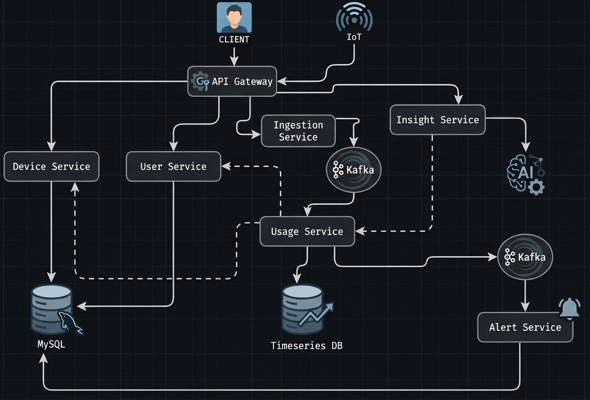
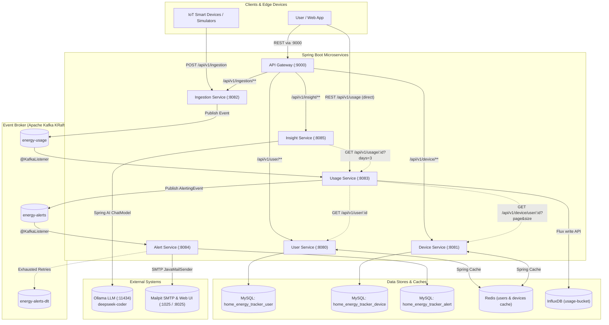
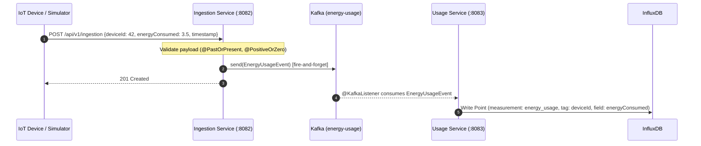
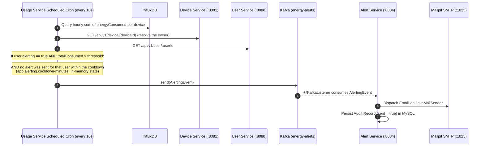
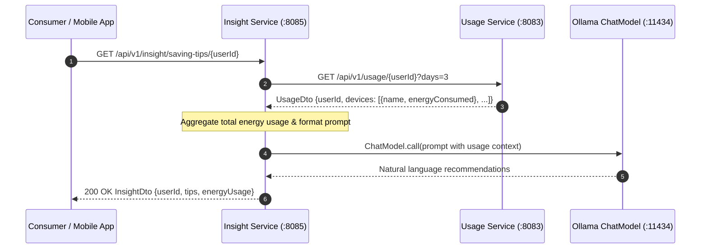
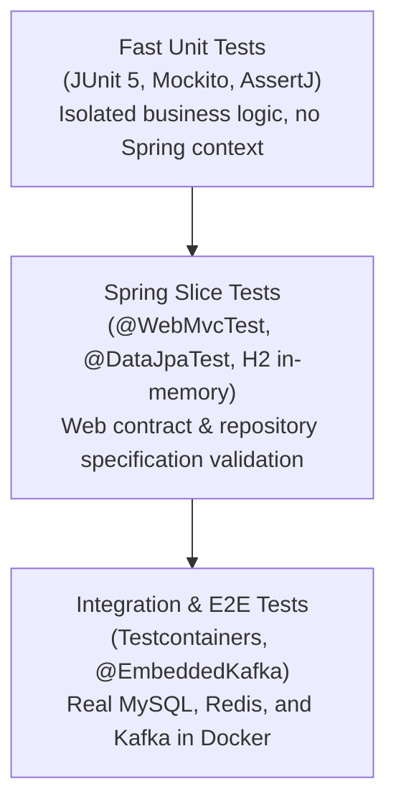

# ⚡ Home Energy Tracker — Microservices Platform

          

> Distributed, event-driven home energy tracking ecosystem built with **Spring Boot 4.1.1**, **Apache Kafka**, **InfluxDB**, **Redis**, **MySQL**, and **Spring AI / Ollama**. It enables real-time IoT energy ingestion, high-speed time-series analytics, automated threshold-based alerting via email, and personalized AI saving tips.

---

## 📑 Table of Contents

- [System Architecture](#-system-architecture)
- [Microservices Overview](#-microservices-overview)
- [Tech Stack](#-tech-stack)
- [Infrastructure & Auxiliary Services](#-infrastructure--auxiliary-services)
  - [Keycloak provisioning and persistence](#-keycloak-provisioning-and-persistence)
- [End-to-End Data Pipelines](#-end-to-end-data-pipelines)
  - [1. Real-time Ingestion & Time-Series Storage](#1-real-time-ingestion--time-series-storage)
  - [2. Threshold-Based Alerting Pipeline](#2-threshold-based-alerting-pipeline)
  - [3. AI-Powered Advisory Pipeline](#3-ai-powered-advisory-pipeline)
- [Interactive API Docs & Dashboards](#-interactive-api-docs--dashboards)
- [Getting Started](#-getting-started)
  - [Prerequisites](#prerequisites)
  - [1. Start Infrastructure with Docker](#1-start-infrastructure-with-docker)
  - [2. Initialize Ollama LLM](#2-initialize-ollama-llm)
  - [3. Start the Microservices](#3-start-the-microservices)
  - [4. Ingest Telemetry Data (Simulator)](#4-ingest-telemetry-data-simulator)
- [Testing the Platform with Postman](#-testing-the-platform-with-postman)
- [Testing Strategy](#-testing-strategy)
- [Repository Structure](#-repository-structure)

---

## 🏗️ System Architecture

The platform is designed around event-driven microservices with autonomous data stores, decoupled asynchronous Kafka pipelines, in-memory caching with Redis, time-series storage with InfluxDB, and local LLM integration via Spring AI and Ollama.



### Global Architecture Diagram



---

## 🧩 Microservices Overview

| Microservice | Port | Primary Storage | Communication | Role & Key Responsibilities | Docs Link |
| :--- | :---: | :--- | :--- | :--- | :---: |
| **[User Service](user-service/README.md)** | `8080` | MySQL + Redis | REST | Manages user profiles, credentials, alerting flags, and personal energy consumption threshold configurations. | [Read README](user-service/README.md) |
| **[Device Service](device-service/README.md)** | `8081` | MySQL + Redis | REST | Manages device inventory (lighting, HVAC, appliances, etc.) associated with registered users. | [Read README](device-service/README.md) |
| **[Ingestion Service](ingestion-service/README.md)** | `8082` | Stateless | REST &rarr; Kafka | High-throughput entrypoint for IoT devices. Validates payload and publishes raw readings to Kafka fire-and-forget. Includes load simulators. | [Read README](ingestion-service/README.md) |
| **[Usage Service](usage-service/README.md)** | `8083` | InfluxDB | Kafka & HTTP | Consumes readings, writes to InfluxDB time-series, aggregates consumption, queries user/device limits, and triggers alert events. | [Read README](usage-service/README.md) |
| **[Alert Service](alert-service/README.md)** | `8084` | MySQL | Kafka &rarr; SMTP | Consumes alert events, formats notification emails, dispatches them via SMTP to Mailpit, and stores audit history with dead-letter fallback. | [Read README](alert-service/README.md) |
| **[Insight Service](insight-service/README.md)** | `8085` | Stateless | REST &rarr; Ollama | Pulls aggregated usage data from Usage Service and orchestrates prompts with local Ollama LLMs for personalized energy-saving recommendations. | [Read README](insight-service/README.md) |
| **[API Gateway](api-gateway/README.md)** | `9000` | Stateless | REST &rarr; REST | Single entry point and security edge for clients. Validates the Keycloak JWT (OAuth2 Resource Server), routes requests to the downstream services and wraps every route in a Resilience4j circuit breaker with a `503` fallback. | [Read README](api-gateway/README.md) |

---

## 🧰 Tech Stack

| Domain | Technology | Version / Spec | Purpose in Ecosystem |
| :--- | :--- | :--- | :--- |
| **Core Framework** | Java | 21 (LTS) | Language baseline with virtual threads & modern records |
| | Spring Boot | 4.1.1 | Application framework across all microservices |
| | Spring WebMVC | (Spring Boot) | Non-blocking/sync REST APIs |
| | Spring AOP / AspectJ | (Spring Boot) | Execution timing and cross-cutting method logging |
| **Messaging** | Apache Kafka | Latest (KRaft mode) | High-throughput event backbone (`energy-usage`, `energy-alerts`) |
| | Spring for Kafka | (Spring Boot) | Event producers, consumers, retry error handlers & DLT recovery |
| **Storage & Caching** | InfluxDB | 2.7 | Time-series database optimized for IoT power metrics (`usage-bucket`) |
| | MySQL | 8.3.0 | Relational storage for users, devices, and alert audit records |
| | Redis | 7 (Alpine) | Distributed caching layer for fast user and device entity lookups |
| | Flyway | (Spring Boot) | Database schema migrations and versioning |
| **Artificial Intelligence** | Spring AI | 2.0.1 | ChatModel abstraction, prompt orchestration, and context injection |
| | Ollama | Local runtime | Local host LLM provider executing `deepseek-coder` |
| **Security** | Spring Security OAuth2 Resource Server | (Spring Boot) | Edge JWT validation in the API Gateway (`SecurityConfig`) |
| | Keycloak | 24.0.1 | Identity provider / authorization server issuing the platform's access tokens |
| | Nimbus JOSE + JWT | (Spring Boot) | JWKS retrieval and JWT signature verification |
| **Observability** | Spring Boot Actuator | (Spring Boot) | Health/info/metrics endpoints exposed by every microservice |
| | Micrometer Prometheus Registry | (Spring Boot) | `/actuator/prometheus` exposition format scraped by Prometheus |
| | Prometheus | 3.1.0 | Metrics scraping & TSDB (15s interval, 5-day retention) |
| | Grafana | 11.4.0 | Dashboards over the provisioned Prometheus datasource |
| **Documentation & Tooling** | SpringDoc OpenAPI | 3.1.1 (api-gateway: 3.0.2) | Automated Swagger UI and OpenAPI 3 schema generation (user, device, ingestion, usage, alert, insight) |
| | Lombok | 1.18.36 | Clean boilerplate reduction for DTOs and models |
| | Mailpit | Latest | Testing SMTP mock server and web UI for outbound notification emails |
| | Testcontainers | 1.21.3 | Automated integration tests against real Dockerized dependencies |

---

## 🐳 Infrastructure & Auxiliary Services

All supporting infrastructure containers are preconfigured in [`docker-compose.yml`](docker-compose.yml):

| Service | Container Name | Host Port | Internal Port | Description / Credentials |
| :--- | :--- | :---: | :---: | :--- |
| **MySQL** | `mysql` | `3306` | `3306` | Root pass: `admin`, DB: `home_energy_tracker` (per-service schemas created on boot) |
| **Redis** | `user-service-redis` | `6379` | `6379` | In-memory key-value cache |
| **Kafka** | `kafka` | `9094` | `9092` | KRaft single-node broker (internal `9092`, host `9094`) |
| **Kafka UI** | `kafka-ui` | `8070` | `8080` | Web UI to inspect topics, partitions, consumer groups, and messages |
| **InfluxDB** | `influxdb` | `8072` | `8086` | Time-series DB (Org: `home-energy-tracker`, Bucket: `usage-bucket`, Token: `my-token`) |
| **Mailpit** | `mailpit` | `8025` / `1025` | `8025` / `1025` | Web client at `8025`, SMTP listener at `1025` |
| **Keycloak** | `keycloak` | `8091` | `8080` | Identity provider / authorization server (admin: `admin` / `admin`, realm: `het-security-realm`, client: `home-energy-tracker-client`). The realm is seeded from `docker/keycloak/realms/` and its data lives in the `keycloak-data` volume |
| **Prometheus** | `prometheus` | `9090` | `9090` | Metrics TSDB — scrapes every service's `/actuator/prometheus` every 15s, 5-day retention |
| **Grafana** | `grafana` | `3000` | `3000` | Dashboards pre-provisioned with the Prometheus datasource (admin: `admin` / `admin`) |

> **Observability:** every service (gateway included) exposes Micrometer metrics on `/actuator/prometheus`. Prometheus reaches them through `host.docker.internal` as declared in [`docker/prometheus/prometheus.yml`](docker/prometheus/prometheus.yml), and Grafana boots with its datasource and dashboard provider already provisioned from [`docker/grafana/provisioning`](docker/grafana/provisioning).
>
> The Prometheus datasource is provisioned with the **pinned uid `prometheus`**, so dashboard JSON files must reference it as `{"type":"prometheus","uid":"prometheus"}`. Any dashboard dropped into [`docker/grafana/provisioning/dashboards/json/`](docker/grafana/provisioning/dashboards/json/) is picked up automatically — the file provider rescans the directory every 30 s, so no restart is needed — and lands in the *Home Energy Tracker* folder.

### 🔐 Keycloak provisioning and persistence

The realm is **not** created by hand any more — it is seeded from versioned files:

| File | Content |
| :--- | :--- |
| [`docker/keycloak/realms/het-security-realm-realm.json`](docker/keycloak/realms/) | Realm `het-security-realm`: 7 clients (`home-energy-tracker-client` plus the built-ins), roles, client scopes, authentication flows, SMTP settings and the realm's signing keys |
| `docker/keycloak/realms/het-security-realm-users-0.json` | Realm users (today only the `home-energy-tracker-client` service account) |

Keycloak starts with `start-dev --import-realm`, so on every boot it imports the JSON files found in `/opt/keycloak/data/import` (the bind-mounted `docker/keycloak/realms/`). Its runtime data is kept in an embedded H2 database under `/opt/keycloak/data`, which is stored in the **`keycloak-data` volume** — that is what makes the realm survive the removal of the container.

> ⚠️ The import uses the `IGNORE_EXISTING` strategy: an existing realm is **never overwritten**. Changes made to the JSON files are only applied when the realm does not exist yet (fresh `keycloak-data` volume or a deleted realm).

| Command | Realm survives? |
| :--- | :---: |
| `docker compose stop` / `start` / `restart keycloak` | ✅ |
| `docker compose down` (or `docker compose rm -f keycloak`) | ✅ — thanks to the `keycloak-data` volume |
| `docker compose down -v` | ❌ — drops every named volume |

**After changing the realm** (new users, clients, roles…) re-export it so the change stays versioned:

```bash
docker exec keycloak /opt/keycloak/bin/kc.sh export \
  --dir /opt/keycloak/data/import --realm het-security-realm
```

The export writes straight into the bind mount, so the JSON files under `docker/keycloak/realms/` are updated on the host and can be committed.

> This is a **local development** setup (`start-dev` + embedded H2). For a production deployment, point Keycloak at MySQL/PostgreSQL with `KC_DB` / `KC_DB_URL` / `KC_DB_USERNAME` / `KC_DB_PASSWORD` instead.

---

## 🔄 End-to-End Data Pipelines

### 1. Real-time Ingestion & Time-Series Storage



### 2. Threshold-Based Alerting Pipeline



### 3. AI-Powered Advisory Pipeline



> ⚠️ **Ollama is not part of `docker-compose.yml`**: it must be running locally on `:11434` with the configured model already pulled. When it is down, `insight-service` answers **`503 Service Unavailable`** (`"Ollama is unavailable: ..."`) in **~1-2 seconds** instead of hanging, thanks to the `spring.ai.retry.*` configuration.

---

## 🔗 Interactive API Docs & Dashboards

When running locally, each service exposes its Swagger UI documentation and actuator metrics:

| Service / Tool | Web Interface / OpenAPI | Key Endpoints |
| :--- | :--- | :--- |
| **User Service** | [http://localhost:8080/swagger-ui.html](http://localhost:8080/swagger-ui.html) | `POST, GET /api/v1/user`, `GET /search`, `PATCH /{id}/alerting` |
| **Device Service** | [http://localhost:8081/swagger-ui.html](http://localhost:8081/swagger-ui.html) | `POST, GET /api/v1/device`, `GET /user/{userId}`, `GET /search` |
| **Ingestion Service** | [http://localhost:8082/swagger-ui.html](http://localhost:8082/swagger-ui.html) | `POST /api/v1/ingestion` |
| **Usage Service** | [http://localhost:8083/swagger-ui.html](http://localhost:8083/swagger-ui.html) | `GET /api/v1/usage/{userId}?days=3` |
| **Alert Service** | Event-Driven Consumer (no REST UI) | Kafka consumer on `energy-alerts` |
| **Insight Service** | [http://localhost:8085/swagger-ui.html](http://localhost:8085/swagger-ui.html) | `GET /api/v1/insight/saving-tips/{userId}`, `GET /overview/{userId}` |
| **Kafka UI (Kafbat)** | [http://localhost:8070](http://localhost:8070) | Topic browsing, partition lag, message replay |
| **InfluxDB Dashboard** | [http://localhost:8072](http://localhost:8072) | Data Explorer, Flux queries over `usage-bucket` |
| **API Gateway** | [http://localhost:9000/swagger-ui.html](http://localhost:9000/swagger-ui.html) | Aggregated specs via `/docs/user-service/v3/api-docs`, `/docs/device-service/v3/api-docs`, `/docs/ingestion-service/v3/api-docs`, `/docs/insight-service/v3/api-docs` and `/docs/usage-service/v3/api-docs` (public) |
| **Keycloak** | [http://localhost:8091](http://localhost:8091) | Admin console + realm `het-security-realm` (issuer, `jwks_uri`, token endpoint) — realm seeded from `docker/keycloak/realms/` |
| **Mailpit UI** | [http://localhost:8025](http://localhost:8025) | Live inbox for alert notifications |
| **Prometheus** | [http://localhost:9090](http://localhost:9090) | Scrape targets & health, PromQL query explorer (`/-/healthy`, `/api/v1/targets`) |
| **Grafana** | [http://localhost:3000](http://localhost:3000) | Metrics dashboards (`admin` / `admin`), Prometheus datasource provisioned |

---

## 🚀 Getting Started

### Prerequisites

- **Java 21 JDK**
- **Maven 3.9+**
- **Docker & Docker Compose**
- **Ollama** (for local AI features)

---

### 1. Start Infrastructure with Docker

From the root repository directory:

```bash
docker compose up -d
```

Verify that all containers (`mysql`, `redis`, `kafka`, `kafka-ui`, `influxdb`, `mailpit`, `keycloak`, `prometheus`, `grafana`) are healthy:

```bash
docker compose ps
```

> **Note on MySQL Databases:**  
> The `docker/mysql/init.sql` script creates `home_energy_tracker`. If connecting each microservice independently, create the individual service databases:
> ```sql
> CREATE DATABASE IF NOT EXISTS home_energy_tracker_user;
> CREATE DATABASE IF NOT EXISTS home_energy_tracker_device;
> CREATE DATABASE IF NOT EXISTS home_energy_tracker_alert;
> ```
> Flyway will automatically run all migrations upon starting each service.

---

### 2. Initialize Ollama LLM

Install Ollama from [ollama.com](https://ollama.com), ensure it is running, and pull the required model:

```bash
ollama serve
ollama pull deepseek-coder
```

---

### 3. Start the Microservices

Recommended startup order:

1. **User Service** (Port `8080`):
   ```bash
   cd user-service && mvn spring-boot:run
   ```
2. **Device Service** (Port `8081`):
   ```bash
   cd device-service && mvn spring-boot:run
   ```
3. **Usage Service** (Port `8083`):
   ```bash
   cd usage-service && mvn spring-boot:run
   ```
4. **Alert Service** (Port `8084`):
   ```bash
   cd alert-service && mvn spring-boot:run
   ```
5. **Ingestion Service** (Port `8082`):
   ```bash
   cd ingestion-service && mvn spring-boot:run
   ```
6. **Insight Service** (Port `8085`):
   ```bash
   cd insight-service && mvn spring-boot:run
   ```
7. **API Gateway** (Port `9000`):
   ```bash
   cd api-gateway && mvn spring-boot:run
   ```
8. **Keycloak** (Port `8091`): started automatically by `docker compose` — no additional command is needed.

> Once the gateway is up, clients can reach the routed services through a single port (`http://localhost:9000/api/v1/...`) instead of calling each service's port directly.

#### Obtain an access token (required by the gateway)

The gateway validates a Bearer JWT on every routed path. Tokens are issued by Keycloak (realm `het-security-realm`, client `home-energy-tracker-client`):

```bash
TOKEN=$(curl -s -X POST \
  http://localhost:8091/realms/het-security-realm/protocol/openid-connect/token \
  -H "Content-Type: application/x-www-form-urlencoded" \
  -d "grant_type=password" \
  -d "client_id=home-energy-tracker-client" \
  -d "client_secret=KHe2IG9JY8uWoSqi8l2gbm5GOLXkVewm" \
  -d "username=<realm-user>" \
  -d "password=<realm-password>" | jq -r '.access_token')
```

Then call the gateway with that token:

```bash
curl -H "Authorization: Bearer $TOKEN" http://localhost:9000/api/v1/user/1
```

> The `/actuator/**`, `/swagger-ui/**`, `/v3/api-docs/**` and `/docs/**` paths remain **public**. See the [API Gateway README](api-gateway/README.md#-security-keycloak--oauth2) for the complete security model.

---

### 4. Ingest Telemetry Data (Simulator)

To test the system end-to-end without physical IoT devices, you can send readings manually:

```bash
curl -X POST http://localhost:8082/api/v1/ingestion \
  -H "Content-Type: application/json" \
  -d '{"deviceId": 1, "energyConsumed": 15.4, "timestamp": "2026-10-22T12:00:00Z"}'
```

Or enable the built-in batch simulators (`ContinuousDataSimulator` or `ParallelDataSimulator`) in `ingestion-service`.

---

## 📮 Testing the Platform with Postman

A preconfigured Postman collection is available in the root repository: [`postman.json`](postman.json).

### How to use:
1. Open **Postman** and click **Import**.
2. Select [`postman.json`](postman.json) from the repository root.
3. The collection contains grouped folders covering:
   - **Security (Keycloak)**: Obtain a JWT access token (password grant, client credentials, refresh) and inspect the realm's OpenID discovery document. The password-grant request stores the token in the `accessToken` collection variable, which every other request inherits as a Bearer token.
   - **API Gateway (routed, Bearer JWT)**: Exercise the routed endpoints through `http://localhost:9000/api/v1/...` with the Bearer token, including a circuit-breaker `503` fallback demo.
   - **User Service**: Create users, list paginated, search by threshold, toggle alerting.
   - **Device Service**: Register devices, assign to users, filter by type (`LIGHT`, `HVAC`, etc.).
   - **Ingestion Service**: Submit single and bulk telemetry readings.
   - **Usage Service**: Query aggregated device energy consumption over custom day ranges.
   - **Insight Service**: Request personalized AI energy saving tips and consumption overviews.

> Collection variables are preconfigured for local development (`gatewayBaseUrl` `:9000`, `keycloakBaseUrl` `:8091`, realm `het-security-realm`, client `home-energy-tracker-client`). The seeded realm contains **no end users yet**, so create one in the Admin console first and set `username` / `password` before requesting a token — then re-export the realm (see [Keycloak provisioning and persistence](#-keycloak-provisioning-and-persistence)) so the user stays versioned.

---

## 🧪 Testing Strategy

The repository applies modern testing practices across all layers:



Run test suites per module (there is no root aggregator POM, so run Maven inside each service folder):
```bash
# From a single service folder:
cd user-service && mvn test

# Or loop over every service from the repository root:
for d in user-service device-service ingestion-service usage-service alert-service insight-service api-gateway; do
  (cd "$d" && mvn -q test) || echo "FAILED: $d"
done
```

---

## 📁 Repository Structure

```
ENERGY_TRACKER
├── docker/                           # Database, identity and monitoring configuration
│   ├── mysql/init.sql
│   ├── keycloak/realms/              # Keycloak realm import/export files (het-security-realm)
│   ├── prometheus/prometheus.yml     # Scrape configuration for the microservices
│   ├── grafana/provisioning/         # Grafana datasource + dashboard provider
│   ├── influxdb_data/
│   └── kafka_data/
├── img/                              # Architectural schematics
│   └── flowchart.jpg
├── user-service/                     # User management & alerting threshold service (:8080)
├── device-service/                   # IoT Device catalog & assignment service (:8081)
├── ingestion-service/                # Raw telemetry ingestor & Kafka producer (:8082)
├── usage-service/                    # Time-series analytics & alert evaluator (:8083)
├── alert-service/                    # Email notification & audit log consumer (:8084)
├── insight-service/                  # AI recommendations using Ollama (:8085)
├── api-gateway/                      # Single entry point + JWT auth + circuit breakers (:9000)
├── docker-compose.yml                # Unified infrastructure definition
├── postman.json                      # Ready-to-import Postman test collection
└── README.md                         # Platform master documentation
```
