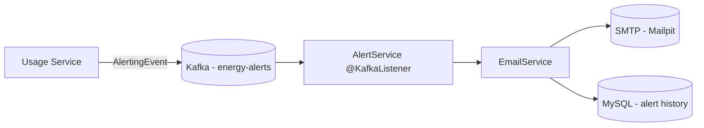
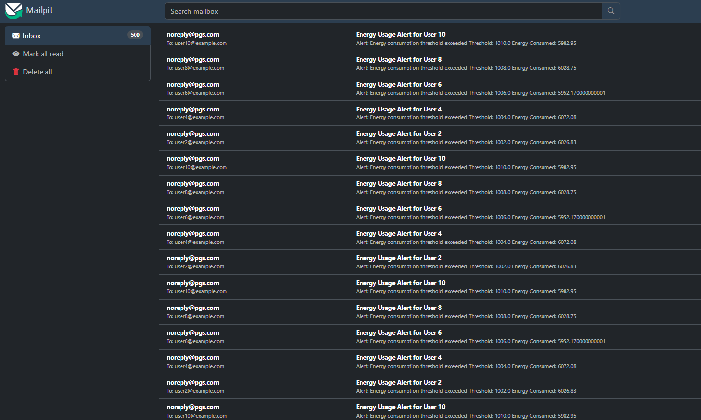
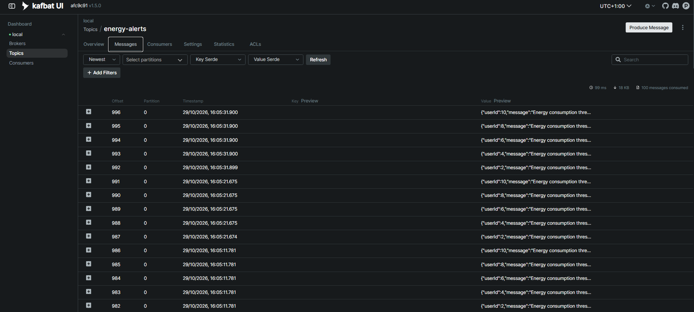

# 🔔 Alert Service

   

> Java Spring Boot microservice that sends notifications for the **Energy Tracker** home energy tracking platform.

The **Alert Service** is a Kafka consumer that reacts to `AlertingEvent` messages published by the **Usage Service** on the `energy-alerts` topic. For each event it builds a human-readable email, sends it through SMTP (Mailpit in local development), and persists an `Alert` audit record so the notification history can be reviewed later.

It does **not** decide *when* an alert must be raised: detection logic lives in the Usage Service. This service only reacts to alert events and forwards them to a notification channel (email today, push/SMS tomorrow), so the channel can evolve independently.

---

## 📑 Table of Contents

- [Architecture](#-architecture)
- [Tech Stack](#-tech-stack)
- [How it works](#-how-it-works)
- [Kafka topics](#-kafka-topics)
- [Reliability: retries & dead-letter](#-reliability-retries--dead-letter)
- [Data Model](#-data-model)
- [Getting Started](#-getting-started)
- [Configuration](#-configuration)
- [Actuator & Metrics](#-actuator--metrics)
- [API Docs](#-api-docs)
- [Testing](#-testing)
- [Project Structure](#-project-structure)
- [Roadmap](#-roadmap)

---

## 🏗️ Architecture

The service is a **reactive, event-driven microservice**: instead of exposing REST endpoints it subscribes to a Kafka topic and reacts to events. The flow is:



- `AlertService` — thin Kafka listener; validates the event and delegates.
- `EmailService` — builds the subject/body, sends via `JavaMailSender`, and persists the outcome.
- `AlertRepository` — JPA repository over the `alert` table.

---

## 🧰 Tech Stack

| Technology           | Version    | Purpose                                    |
| -------------------- | ---------- | ------------------------------------------ |
| Java                 | 21         | Language / runtime                         |
| Spring Boot          | 4.1.1      | Application framework                      |
| Spring Kafka         | (SB)       | Event consumption & dead-letter publishing |
| Spring Mail          | (SB)       | Email delivery via `JavaMailSender`        |
| Spring Data JPA      | (SB)       | Persistence / repositories                 |
| Hibernate            | (SB)       | ORM implementation                         |
| AspectJ (Spring AOP) | (SB)       | Aspect-oriented logging / timing           |
| Spring Boot Actuator | (SB)       | Health, info and metrics endpoints         |
| Micrometer Prometheus Registry | (SB) | Metrics in Prometheus exposition format |
| MySQL                | 8          | Production database                        |
| H2                   | (SB)       | Embedded DB for tests                      |
| Flyway               | (SB)       | Database migrations                        |
| SpringDoc OpenAPI    | 3.1.1      | Service metadata / Swagger UI              |
| Lombok               | 1.18.36    | Boilerplate reduction                      |
| Maven                | —          | Build tool                                 |
| Docker               | —          | Local infra via `docker-compose`           |
| JUnit 5 / Mockito / AssertJ | —  | Testing                                    |

---

## 🔔 How it works

1. The **Usage Service** runs a scheduled task that aggregates device consumption. When a user exceeds their energy threshold (and has alerting enabled), it publishes an `AlertingEvent`:

```json
{
  "userId": 1,
  "message": "Energy consumption threshold exceeded",
  "threshold": 100.0,
  "energyConsumed": 150.0,
  "email": "ana@example.com"
}
```

2. `AlertService.energyUsageAlertEvent` consumes the event from `energy-alerts`.
3. `EmailService` sends the email and stores an `Alert` row with `sent = true/false`.


*Mailpit → **Inbox**: one "Energy Usage Alert for User N" email per breach, showing the configured threshold and the measured consumption.*

---

## 📦 Kafka topics

| Topic              | Direction  | Description                                            |
| ------------------ | ---------- | ------------------------------------------------------ |
| `energy-alerts`    | consumer   | Incoming `AlertingEvent`s produced by the Usage Service |
| `energy-alerts-dlt`| producer   | Dead-letter topic for events that exhausted their retries |

Topic names are centralized in `application.properties` (`app.kafka.alerts.topic` / `app.kafka.alerts.dlt-topic`) instead of being hard-coded.


*Kafbat UI → **Topics → `energy-alerts`**: the `AlertingEvent` payloads this service consumes (`userId`, `message`, `threshold`, `energyConsumed`, `email`).*

---

## 🛡️ Reliability: retries & dead-letter

`KafkaConfig` customizes the listener container factory (`kafkaListenerContainerFactory`) with a `DefaultErrorHandler`:

- Failed records are retried up to **3 attempts** with a **5 s** fixed back-off.
- After the last attempt the record is republished to the dead-letter topic via a `DeadLetterPublishingRecoverer`, so no alert event is silently lost and the DLT can be inspected / replayed later (e.g. with Kafka UI at `http://localhost:8070`).

Note: a transient SMTP failure is **not** retried by Kafka on purpose — `EmailService` swallows the `MailException` and persists `sent = false` so the failure is recorded in the audit history. Kafka-level retry/DLT is reserved for unrecoverable processing errors (e.g. the database write fails).

---

## 🗃️ Data Model

```sql
CREATE TABLE `alert` (
  `id`              BIGINT NOT NULL AUTO_INCREMENT,
  `user_id`         BIGINT,
  `message`         VARCHAR(500),
  `threshold`       DOUBLE,
  `energy_consumed` DOUBLE,
  `email`           VARCHAR(255),
  `sent`            TINYINT(1) NOT NULL DEFAULT 0,
  `created_at`      TIMESTAMP NOT NULL DEFAULT CURRENT_TIMESTAMP,
  PRIMARY KEY (`id`),
  KEY `idx_alert_user_id` (`user_id`),
  KEY `idx_alert_sent` (`sent`)
) ENGINE=InnoDB DEFAULT CHARSET=utf8mb4 COLLATE=utf8mb4_unicode_ci;
```

Migrations are versioned with Flyway (`V1` initial table, `V2` audit content + indexes).

---

## 🚀 Getting Started

Prerequisites: **JDK 21**, **Maven**, and Docker (for the infrastructure).

1. Start the infrastructure (MySQL, Kafka, Mailpit, ...):

```bash
docker compose up -d
```

2. Make sure the `alert` database exists in MySQL (the `docker/mysql/init.sql` script creates it on first boot).

3. Run the service:

```bash
cd alert-service
./mvnw spring-boot:run
```

4. Send a test alert from another shell (Kafka CLI) or let the Usage Service generate one automatically:

```bash
docker exec -i kafka /opt/kafka/bin/kafka-console-producer.sh \
  --bootstrap-server localhost:9092 --topic energy-alerts
```

Paste a JSON event and press Enter; the email appears in the **Mailpit** UI at `http://localhost:8025`.

### Running as a container

This service ships a `Dockerfile` (multi-stage build, non-root user, `HEALTHCHECK` on `/actuator/health`) and belongs to the Compose `app` profile:

```bash
# from the repository root: infrastructure + all seven microservices
docker compose --env-file .env.docker up -d --build

# or just this service (the infrastructure must already be running)
docker compose --env-file .env.docker up -d --build alert-service
```

| Environment variable | Default (host run) | Value injected by Compose |
| :--- | :--- | :--- |
| `KAFKA_BOOTSTRAP_SERVERS` | `localhost:9094` (external listener) | `kafka:9092` (internal listener) |
| `MYSQL_URL` | `jdbc:mysql://localhost:3306/home_energy_tracker_alert` | `jdbc:mysql://mysql:3306/home_energy_tracker_alert` |
| `SPRING_MAIL_HOST` | `localhost` | `mailpit` |

> The container waits for Kafka and MySQL to report healthy before starting. The service exposes no REST endpoints, but its `/actuator/health` is still used as the container health check.

---

## ⚙️ Configuration

| Property                                       | Default                        | Description                              |
| ---------------------------------------------- | ------------------------------ | ---------------------------------------- |
| `server.port`                                  | `8084`                         | HTTP port                                |
| `spring.kafka.bootstrap-servers`               | `localhost:9094`               | Kafka broker (external listener)         |
| `app.kafka.alerts.topic`                       | `energy-alerts`                | Incoming alerts topic                    |
| `spring.kafka.consumer.group-id`               | `alert-service`                | Consumer group id                        |
| `spring.datasource.url`                        | `jdbc:mysql://localhost:3306/home_energy_tracker_alert` | Alert database   |
| `spring.mail.host` / `spring.mail.port`        | `localhost` / `1025`           | SMTP server (Mailpit)                    |
| `management.endpoints.web.exposure.include`    | `health,info,prometheus`       | Actuator endpoints exposed               |
| `management.endpoint.health.show-details`      | `when-authorized`              | Health detail visibility                 |
| `management.metrics.tags.application`          | `alert-service`                | Common tag added to all metrics          |
| `springdoc.swagger-ui.path`                    | `/swagger-ui.html`             | Swagger UI path                          |
| `springdoc.api-docs.path`                      | `/v3/api-docs`                 | OpenAPI spec path                        |

---

## 📖 API Docs

The service is a pure Kafka consumer and exposes **no REST endpoints** of its own, but it still ships the OpenAPI integration so its metadata and actuator surface are documented like the rest of the platform:

- Swagger UI → `http://localhost:8084/swagger-ui.html`
- OpenAPI spec → `http://localhost:8084/v3/api-docs`

The document is declared in `config/OpenApiConfig.java` (`@OpenAPIDefinition`). No `springdoc.group-configs` entry is registered because there are no REST paths to group; the alerting behaviour is documented as an event flow in the sections above.

---

## 📊 Actuator & Metrics

The service ships **Spring Boot Actuator** and the **Micrometer Prometheus registry**, so its runtime metrics are exposed in Prometheus exposition format and scraped every 15 seconds by the `prometheus` container declared in [`docker-compose.yml`](../docker-compose.yml) (job `alert-service` in [`docker/prometheus/prometheus.yml`](../docker/prometheus/prometheus.yml)).

Because the service is a pure Kafka consumer, actuator is the **only** HTTP surface it exposes — useful to verify that the consumer is alive and to watch throughput/lag-related meters.

| Endpoint               | Purpose                                                 |
| ---------------------- | ------------------------------------------------------- |
| `/actuator/health`     | Liveness / readiness probe (DB, Kafka, SMTP, disk)       |
| `/actuator/info`       | Application & build information                         |
| `/actuator/prometheus` | Metrics in Prometheus exposition format (scrape target) |

```bash
curl http://localhost:8084/actuator/health
curl http://localhost:8084/actuator/prometheus
```

Every meter is tagged with `application=alert-service` (`management.metrics.tags.application`), which makes per-service filtering trivial in Grafana — reachable at [http://localhost:3000](http://localhost:3000) (`admin` / `admin`) with the Prometheus datasource already provisioned.

---

## 🧪 Testing

```bash
cd alert-service
./mvnw test          # macOS/Linux
.\mvnw.cmd test      # Windows
```

The suite runs **without external infrastructure** (no Docker/MySQL/Kafka required):

| Test                        | Level       | What it verifies                                                      |
| --------------------------- | ----------- | -------------------------------------------------------------------- |
| `AlertServiceTest`          | Unit        | Listener delegation + null-guards (`EmailService` mocked)            |
| `EmailServiceTest`          | Unit        | Email sent / persisted with `sent=true`, and `sent=false` on failure |
| `AlertKafkaIntegrationTest` | Integration | Full chain over an embedded Kafka broker: consume → email → persist  |

Current status: **8 tests, 0 failures**.

- The integration test uses `@EmbeddedKafka` (broker address auto-registered in `spring.kafka.bootstrap-servers`) and `@MockitoBean` for `JavaMailSender` and `AlertRepository`.
- `src/test/resources/application.properties` swaps MySQL for H2 and disables Flyway.

---

## 📁 Project Structure

```
alert-service
├── Dockerfile                 # Multi-stage build: maven:3.9 + JRE 21, non-root user, /actuator/health healthcheck
├── .dockerignore              # Keeps target/, doc/ and the IDE files out of the build context
├── mvnw / mvnw.cmd            # Maven wrapper (./mvnw test on macOS/Linux, .\mvnw.cmd test on Windows)
├── .mvn/wrapper/maven-wrapper.properties
├── pom.xml
├── src
│   ├── main
│   │   ├── java/com/pgs/alert/service
│   │   │   ├── AlertServiceApplication.java
│   │   │   ├── aspect
│   │   │   │   ├── ExecutionTimeAspect.java
│   │   │   │   └── LoggingAspect.java
│   │   │   ├── config
│   │   │   │   ├── KafkaConfig.java
│   │   │   │   └── OpenApiConfig.java
│   │   │   ├── entity
│   │   │   │   └── Alert.java
│   │   │   ├── repository
│   │   │   │   └── AlertRepository.java
│   │   │   └── service
│   │   │       ├── AlertService.java
│   │   │       └── EmailService.java
│   │   ├── java/com/pgs/kafka/event
│   │   │   └── AlertingEvent.java
│   │   └── resources
│   │       ├── application.properties
│   │       └── db/migration
│   │           ├── V1__alert_table.sql
│   │           └── V2__alert_audit_and_indexes.sql
│   └── test
│       ├── resources
│       │   └── application.properties
│       └── java/com/pgs/alert/service
│           ├── AlertServiceApplicationTests.java
│           ├── integration
│           │   └── AlertKafkaIntegrationTest.java
│           └── service
│               ├── AlertServiceTest.java
│               └── EmailServiceTest.java
```

---

## 🗺️ Roadmap

- [ ] Add a REST admin endpoint to list / re-send failed alerts (`sent = false`).
- [ ] Add non-blocking retries for transient SMTP failures with a retry topic.
- [ ] Switch from plain-text to a templated HTML email.
- [ ] Move `AlertingEvent` to a shared Kafka events module to avoid contract duplication with the Usage Service.
