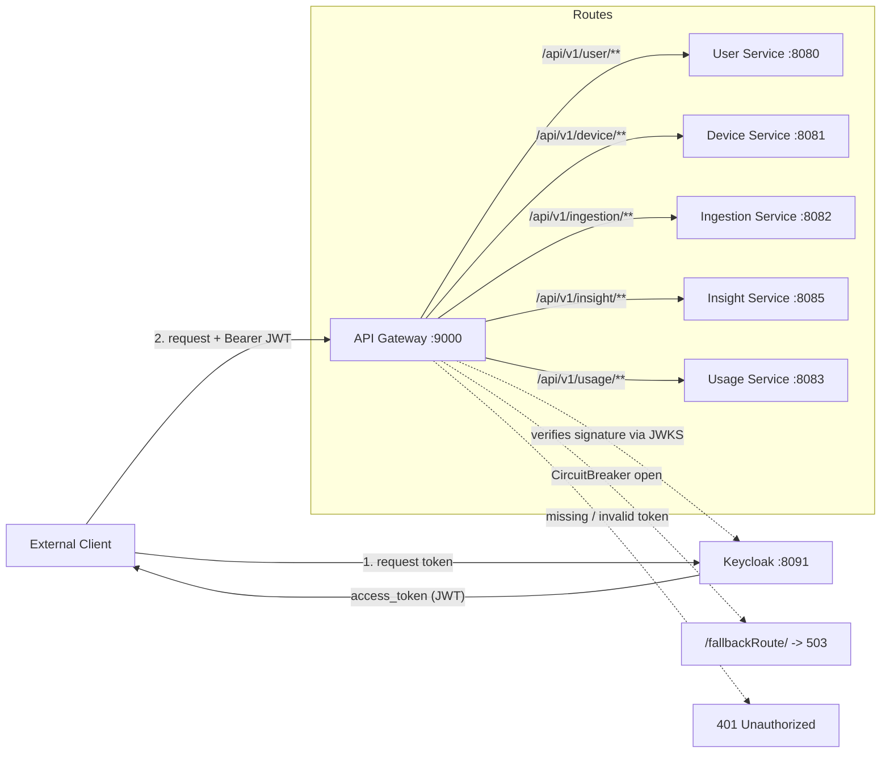

# 🚪 API Gateway

     

> Java Spring Boot microservice that provides a single entry point, authentication and resilience layer for the **Energy Tracker** home energy tracking platform.

The **API Gateway** is the front door of the platform. It exposes one HTTP port (`9000`) and forwards incoming requests to the individual microservices, so clients do not need to know each service's host or port. It is also the platform's **security edge**: it runs as an **OAuth2 Resource Server** and validates the `Authorization: Bearer <JWT>` header against the **Keycloak** realm before a request is routed. Every route is additionally protected by a **Resilience4j circuit breaker**: when a downstream service becomes unhealthy, the gateway opens the circuit and returns a fast `503 Service Unavailable` fallback instead of letting requests pile up. It is a **stateless** service — it owns no database, consumes no Kafka topics and publishes no events.

---

## 📑 Table of Contents

- [Architecture](#-architecture)
- [Tech Stack](#-tech-stack)
- [Security (Keycloak / OAuth2)](#-security-keycloak--oauth2)
- [Getting a Token](#-getting-a-token)
- [Routing Table](#-routing-table)
- [API Docs Proxying](#-api-docs-proxying)
- [Circuit Breaker Configuration](#-circuit-breaker-configuration)
- [Getting Started](#-getting-started)
- [Configuration](#-configuration)
- [Actuator Endpoints](#-actuator-endpoints)
- [Testing](#-testing)
- [Error Handling](#-error-handling)
- [Project Structure](#-project-structure)
- [Roadmap](#-roadmap)

---

## 🏗️ Architecture

The gateway is built with **Spring Cloud Gateway (WebMVC flavour)**: each downstream service is declared as a `RouterFunction` bean that matches a path predicate, forwards to the service's base URI, and applies a circuit-breaker filter. On failure the filter forwards to a `/fallbackRoute` that answers with `503`. Authentication happens **before** routing: every routed request must carry a valid Keycloak JWT.



Each route class defines up to three beans:

- the **route** itself (`path predicate → uri(...)` + circuit breaker filter);
- a **fallback route** per service (`/fallbackRoute/<service>`) returning `503 Service Unavailable` with its own message;
- for the user, device, ingestion, insight and usage services, an **API docs route** that proxies the OpenAPI spec.

Cross-cutting security lives in a separate configuration class, `config/SecurityConfig.java` (see [Security](#-security-keycloak--oauth2)), and the OpenAPI metadata for the gateway itself is declared in `config/OpenApiConfig.java`. Two aspects add cross-cutting tracing: `aspect/LoggingAspect.java` (invocation/return of route and config methods) and `aspect/ExecutionTimeAspect.java` (timing of the route beans).

---

## 🧰 Tech Stack

| Technology                                | Version    | Purpose                                        |
| ----------------------------------------- | ---------- | ---------------------------------------------- |
| Java                                      | 21         | Language / runtime                             |
| Spring Boot                               | 4.1.1      | Application framework                          |
| Spring Cloud                              | 2025.1.3   | Dependency management for the gateway stack    |
| Spring Cloud Gateway (WebMVC)             | (SC)       | Programmatic `RouterFunction` routes           |
| Resilience4j Circuit Breaker              | (SC)       | Per-route circuit breaker + health indicator   |
| Spring Security OAuth2 Resource Server    | (SB)       | JWT validation at the edge (`SecurityConfig`)  |
| Keycloak                                  | 24.0.1     | Identity provider / authorization server       |
| Nimbus JOSE + JWT                         | (SB)       | JWKS retrieval & JWT signature verification    |
| SpringDoc OpenAPI                         | 3.0.2      | Swagger UI + aggregated OpenAPI specs          |
| Spring AOP / AspectJ                      | (SB)       | Route/configuration logging and timing aspects |
| Spring Boot Actuator                      | (SB)       | Health, info, metrics, circuit breaker status  |
| Micrometer Prometheus Registry            | (SB)       | `/actuator/prometheus` metrics endpoint        |
| Lombok                                    | 1.18.36    | Boilerplate reduction (compiler plugin)        |
| Maven Wrapper                             | —          | Build tool (`mvnw` / `mvnw.cmd`)               |
| Docker                                    | —          | Local infra via `docker-compose`               |
| JUnit 5                                   | (SB)       | Context-load smoke test                        |

> The gateway uses the **WebMVC** gateway implementation (`spring-cloud-starter-gateway-server-webmvc`), not the reactive Netty one. Routes are declared in Java configuration, not in `application.yml`.

---

## 🔐 Security (Keycloak / OAuth2)

The gateway runs as an **OAuth2 Resource Server**: it validates the `Authorization: Bearer <JWT>` header of every incoming request against the **Keycloak** realm *before* the request is routed. Authentication is enforced by `config/SecurityConfig.java` — a `SecurityFilterChain` that marks a set of public paths as `permitAll()` and requires authentication for everything else, plus a `JwtDecoder` bean backed by the realm's JWKS.

Keycloak is part of the local infrastructure and is started with the rest of the platform (`docker compose up -d`). It listens on port **`8091`**.

| Item                | Value                                                                                |
| ------------------- | ------------------------------------------------------------------------------------ |
| Keycloak base URL   | `http://localhost:8091`                                                              |
| Realm               | `het-security-realm`                                                                 |
| Client ID           | `home-energy-tracker-client`                                                         |
| Client secret       | `KHe2IG9JY8uWoSqi8l2gbm5GOLXkVewm` *(development only)*                              |
| Issuer (`iss`)      | `http://localhost:8091/realms/het-security-realm`                                    |
| `jwks_uri`          | `http://localhost:8091/realms/het-security-realm/protocol/openid-connect/certs`      |
| Token endpoint      | `http://localhost:8091/realms/het-security-realm/protocol/openid-connect/token`      |
| Introspection       | `http://localhost:8091/realms/het-security-realm/protocol/openid-connect/token/introspect` |
| UserInfo            | `http://localhost:8091/realms/het-security-realm/protocol/openid-connect/userinfo`   |
| Logout              | `http://localhost:8091/realms/het-security-realm/protocol/openid-connect/logout`     |
| Admin console       | `http://localhost:8091` (admin credentials: `admin` / `admin`)                        |

### Supported grant types

The realm's `home-energy-tracker-client` advertises the following `grant_types_supported`: `authorization_code`, `implicit`, `refresh_token`, `password`, `client_credentials`, `urn:openid:params:grant-type:ciba` and `urn:ietf:params:oauth:grant-type:device_code`. For local testing, the **`password`** and **`client_credentials`** grants are the most convenient (see [Getting a Token](#-getting-a-token)).

### How the JWT is validated

1. The client sends `Authorization: Bearer <access_token>` to the gateway.
2. `NimbusJwtDecoder` — built from the `keycloak.auth.jwk-set-uri` property — retrieves the realm's public signing keys from the JWKS endpoint and verifies the token **signature**.
3. Spring Security applies the `authorizeHttpRequests` rules; missing, malformed, expired or tampered tokens are rejected with `401 Unauthorized` before any route predicate is evaluated.

> ℹ️ The `JwtDecoder` is defined explicitly as a `@Bean`, so Spring Boot's `issuer-uri` auto-configuration is bypassed and the `iss` claim is **not** currently validated. See the [Roadmap](#-roadmap).

### Protected vs. public endpoints

| Endpoint group                                                                       | Access         | Notes                                          |
| ------------------------------------------------------------------------------------ | -------------- | ---------------------------------------------- |
| `/api/v1/user/**`, `/api/v1/device/**`, `/api/v1/ingestion/**`, `/api/v1/insight/**`, `/api/v1/usage/**` | 🔒 Bearer JWT  | A valid access token is required               |
| `/actuator/**`                                                                       | 🌐 Public      | Health, info, metrics, circuit breakers, Prometheus |
| `/swagger-ui.html`, `/swagger-ui/**`, `/v3/api-docs/**`, `/docs/**`                  | 🌐 Public      | Swagger UI and the proxied OpenAPI specs       |

The public list is driven by the `security.excluded.urls` property (see [Configuration](#-configuration)).

### Downstream propagation

The gateway does **not** strip the `Authorization` header: the JWT presented at the edge is forwarded untouched to the downstream service, which can read its claims (e.g. `sub`, `preferred_username`) if needed. Authentication is currently enforced **only** at the gateway — the downstream services do not validate tokens themselves.

> ⚠️ **Security note:** the client secret listed above is a **local development** value documented for convenience. Never reuse it in a shared or production environment; inject it through an environment variable or a secret manager instead.

---

## 🔑 Getting a Token

Every routed endpoint requires a Bearer token issued by Keycloak. Start the infrastructure first (`docker compose up -d` from the repository root), then request a token.

### Password grant (user credentials)

```bash
TOKEN=$(curl -s -X POST \
  "http://localhost:8091/realms/het-security-realm/protocol/openid-connect/token" \
  -H "Content-Type: application/x-www-form-urlencoded" \
  -d "grant_type=password" \
  -d "client_id=home-energy-tracker-client" \
  -d "client_secret=KHe2IG9JY8uWoSqi8l2gbm5GOLXkVewm" \
  -d "username=<realm-user>" \
  -d "password=<realm-password>" | jq -r '.access_token')
```

### Client credentials grant (service to service)

```bash
TOKEN=$(curl -s -X POST \
  "http://localhost:8091/realms/het-security-realm/protocol/openid-connect/token" \
  -H "Content-Type: application/x-www-form-urlencoded" \
  -d "grant_type=client_credentials" \
  -d "client_id=home-energy-tracker-client" \
  -d "client_secret=KHe2IG9JY8uWoSqi8l2gbm5GOLXkVewm" | jq -r '.access_token')
```

### Call the gateway with the token

```bash
curl -H "Authorization: Bearer $TOKEN" http://localhost:9000/api/v1/user/1
```

> The same flow is preconfigured in [`postman.json`](../postman.json) inside the **🔐 Security (Keycloak)** folder: the *Get access token (password grant)* request stores the token in the `accessToken` collection variable, which every other request inherits as a Bearer token.

---

## 🔗 Routing Table

The gateway listens on port **`9000`** and matches the following path predicates:

| Path predicate            | Downstream service         | Target URI                 | Circuit breaker id               | Auth          |
| ------------------------- | -------------------------- | -------------------------- | -------------------------------- | ------------- |
| `/api/v1/user/**`         | User Service (`:8080`)     | `http://localhost:8080`    | `userServiceCircuitBreaker`      | 🔒 Bearer JWT |
| `/api/v1/device/**`       | Device Service (`:8081`)   | `http://localhost:8081`    | `deviceServiceCircuitBreaker`    | 🔒 Bearer JWT |
| `/api/v1/ingestion/**`    | Ingestion Service (`:8082`)| `http://localhost:8082`    | `ingestionServiceCircuitBreaker` | 🔒 Bearer JWT |
| `/api/v1/insight/**`      | Insight Service (`:8085`)  | `http://localhost:8085`    | `insightServiceCircuitBreaker`   | 🔒 Bearer JWT |
| `/api/v1/usage/**`        | Usage Service (`:8083`)    | `http://localhost:8083`    | `usageServiceCircuitBreaker`     | 🔒 Bearer JWT |
| `/fallbackRoute/user`      | — (internal)               | responds `503`             | —                                | 🔒 Bearer JWT |
| `/fallbackRoute/device`    | — (internal)               | responds `503`             | —                                | 🔒 Bearer JWT |
| `/fallbackRoute/ingestion` | — (internal)               | responds `503`             | —                                | 🔒 Bearer JWT |
| `/fallbackRoute/insight`   | — (internal)               | responds `503`             | —                                | 🔒 Bearer JWT |
| `/fallbackRoute/usage`     | — (internal)               | responds `503`             | —                                | 🔒 Bearer JWT |

> All routed paths require a valid Keycloak JWT: requests without one are rejected with `401 Unauthorized` before the route predicate is evaluated (see [Security](#-security-keycloak--oauth2)).

When the circuit for a route is open, the request is forwarded to the fallback path of **that** service (`/fallbackRoute/<service>`), which returns its own message:

```http
HTTP/1.1 503 Service Unavailable

<User|Device|Ingestion|Insight|Usage> service is down
```

> ⚠️ Each service owns its fallback path. They used to share a single `/fallbackRoute` and, since only the first registered fallback route resolves a path, **any** open circuit answered `"Device service is down"` — a call to insight reported the wrong service. `ServiceFallbackRoutesTest` locks the behaviour in place.

---

## 📖 API Docs Proxying

The gateway proxies the OpenAPI specifications of the downstream services so clients can discover them through a single Swagger UI. The aggregated UI is declared with `springdoc.swagger-ui.urls[*]`:

| Gateway path                        | Proxied to                          | Swagger UI entry  |
| ----------------------------------- | ----------------------------------- | ----------------- |
| `/docs/user-service/v3/api-docs`    | `http://localhost:8080/v3/api-docs` | `User Service`    |
| `/docs/device-service/v3/api-docs`  | `http://localhost:8081/v3/api-docs` | `Device Service`  |
| `/docs/ingestion-service/v3/api-docs` | `http://localhost:8082/v3/api-docs` | `Ingestion Service` |
| `/docs/insight-service/v3/api-docs` | `http://localhost:8085/v3/api-docs` | `Insight Service` |
| `/docs/usage-service/v3/api-docs`   | `http://localhost:8083/v3/api-docs` | `Usage Service`   |

The gateway's own Swagger UI is available at `http://localhost:9000/swagger-ui.html`. The documentation paths (`/docs/**`, `/v3/api-docs/**`, `/swagger-ui/**`) are **public** — they are excluded from JWT authentication so the specs stay browsable without a token.

> **alert-service** (`:8084`) is intentionally **not** aggregated: it is a pure Kafka consumer with no REST endpoints, so its OpenAPI document contains no `paths`. See the [Roadmap](#-roadmap).

---

## ⚙️ Circuit Breaker Configuration

Circuit breakers are configured globally in `application.properties` under `resilience4j.circuitbreaker.configs.default`:

| Property                                        | Value         | Meaning                                              |
| ----------------------------------------------- | ------------- | ---------------------------------------------------- |
| `slidingWindowType`                             | `COUNT_BASED` | Failure rate is computed over the last N calls       |
| `slidingWindowSize`                             | `8`           | Number of calls in the sliding window                |
| `failureRateThreshold`                          | `20`          | Open the circuit when ≥ 20% of calls fail            |
| `minimum-number-of-calls`                       | `4`           | Minimum calls before the failure rate is evaluated   |
| `waitDurationInOpenState`                       | `5s`          | Time to stay open before transitioning to half-open  |
| `permittedNumberOfCallsInHalfOpenState`         | `2`           | Trial calls allowed while half-open                  |
| `automaticTransitionFromOpenToHalfOpenEnabled`  | `true`        | Automatically move to half-open after the wait       |

Each breaker also registers a health indicator (`registerHealthIndicator=true`), so its state is visible under `/actuator/health` and `/actuator/circuitbreakers`.

### ⏱️ Time limiter

The circuit-breaker filter also wraps every routed call in a `TimeLimiter`. Resilience4j's default timeout is **1 second**, which is shorter than a chat-model call, so it must be raised:

| Property                                                    | Value | Meaning                                                                                  |
| ----------------------------------------------------------- | ----- | ---------------------------------------------------------------------------------------- |
| `resilience4j.timelimiter.configs.default.timeout-duration`  | `30s` | Maximum time a routed call may take before it is cancelled and counted as a failure       |

> Without this, every call to `/api/v1/insight/**` (1-6 s) was cancelled at 1 s, recorded as a failure and answered with the fallback `503`, so the route could never return `200`.

---

## 🚀 Getting Started

### Prerequisites

- Java 21 and the bundled Maven Wrapper (`mvnw`).
- The downstream services running on their respective ports (see the platform [README](../README.md)).
- **Keycloak** running on `http://localhost:8091` with the `het-security-realm` realm and the `home-energy-tracker-client` client — started together with the rest of the local infrastructure via `docker compose up -d` from the repository root. The realm and the client are **seeded from `docker/keycloak/realms/`** on every Keycloak boot, and its data is persisted in the `keycloak-data` volume (see [Keycloak provisioning and persistence](../README.md#-keycloak-provisioning-and-persistence)).
- A valid access token for the calls you want to make (see [Getting a Token](#-getting-a-token)).

### Run the gateway

```bash
cd api-gateway
./mvnw spring-boot:run        # macOS/Linux
.\mvnw.cmd spring-boot:run    # Windows
```

The gateway starts on `http://localhost:9000`.

### Verify

```bash
# 1. Obtain an access token from Keycloak (see "Getting a Token" for the full command)
TOKEN="<paste-your-access-token>"

# 2. Routed request through the gateway (same contract as calling the user service directly)
curl -H "Authorization: Bearer $TOKEN" http://localhost:9000/api/v1/user/1

# 3. Same call without a token -> 401 Unauthorized
curl -i http://localhost:9000/api/v1/user/1

# 4. Gateway health (public, includes circuit breaker states)
curl http://localhost:9000/actuator/health

# 5. Aggregated Swagger UI (public)
open http://localhost:9000/swagger-ui.html
```

---

## 🔧 Configuration

Key properties from `src/main/resources/application.properties`:

| Property                                            | Default                | Description                                     |
| --------------------------------------------------- | ---------------------- | ----------------------------------------------- |
| `spring.application.name`                           | `api-gateway`          | Application name                                |
| `server.port`                                       | `9000`                 | HTTP port of the gateway                        |
| `management.health.circuitbreakers.enabled`         | `true`                 | Expose circuit breaker state in health checks   |
| `management.endpoint.health.show-details`           | `always`               | Show full health details                        |
| `management.endpoints.web.exposure.include`         | `health,info,metrics,circuitbreakers,prometheus` | Exposed actuator endpoints       |
| `management.metrics.tags.application`               | `${spring.application.name}` | Tag attached to every exported metric     |
| `resilience4j.circuitbreaker.configs.default.*`     | see table above        | Default circuit breaker tuning                  |
| `resilience4j.timelimiter.configs.default.timeout-duration` | `30s`          | Maximum duration of a routed call before it is cancelled (see [Time limiter](#️-time-limiter)) |
| `keycloak.auth.jwk-set-uri`                         | `http://localhost:8091/realms/het-security-realm/protocol/openid-connect/certs` | JWKS endpoint used by the `JwtDecoder` |
| `spring.security.oauth2.resourceserver.jwt.issuer-uri` | `http://localhost:8091/realms/het-security-realm` | Expected token issuer (`iss`)      |
| `security.excluded.urls`                            | `/actuator/**, /swagger-ui.html, /swagger-ui/**, /docs/**, /v3/api-docs/**, /swagger-resources/**, /api-docs/**` | Paths that bypass authentication |
| `springdoc.swagger-ui.path`                         | `/swagger-ui.html`     | Swagger UI entry point                          |
| `springdoc.api-docs.path`                           | `/v3/api-docs`         | OpenAPI spec of the gateway itself              |
| `springdoc.swagger-ui.urls[0].name` / `.url`        | `User Service` / `/docs/user-service/v3/api-docs` | First aggregated spec in Swagger UI |
| `springdoc.swagger-ui.urls[1].name` / `.url`        | `Device Service` / `/docs/device-service/v3/api-docs` | Second aggregated spec in Swagger UI |
| `springdoc.swagger-ui.urls[2].name` / `.url`        | `Ingestion Service` / `/docs/ingestion-service/v3/api-docs` | Third aggregated spec in Swagger UI |
| `springdoc.swagger-ui.urls[3].name` / `.url`        | `Insight Service` / `/docs/insight-service/v3/api-docs` | Fourth aggregated spec in Swagger UI |
| `springdoc.swagger-ui.urls[4].name` / `.url`        | `Usage Service` / `/docs/usage-service/v3/api-docs` | Fifth aggregated spec in Swagger UI |

Downstream base URIs are currently **hardcoded** in the route classes (`http://localhost:8080`, `:8081`, `:8082`, `:8083`, `:8085`).

> ⚠️ In `application.properties` the issuer property is currently spelled `spring.security.oauth2.resourceserver.jwt,issuer-uri` (a comma instead of a dot), so Spring Boot does not bind it. It is documented here in its canonical form; see the [Roadmap](#-roadmap).

---

## 🩺 Actuator Endpoints

| Endpoint                       | Purpose                                          |
| ------------------------------ | ------------------------------------------------ |
| `/actuator/health`             | Overall health + per-breaker state               |
| `/actuator/info`               | Application info                                 |
| `/actuator/metrics`            | Metrics                                          |
| `/actuator/circuitbreakers`    | Current state of every circuit breaker           |
| `/actuator/prometheus`         | Metrics in Prometheus exposition format          |

> All `/actuator/**` endpoints are **public** — they are part of `security.excluded.urls`, so health probes and metric scrapers do not need a JWT.

---

## 🧪 Testing

```bash
cd api-gateway
./mvnw test          # macOS/Linux
.\mvnw.cmd test      # Windows
```

| Test                          | Level       | What it verifies                                  |
| ----------------------------- | ----------- | ------------------------------------------------- |
| `ApiGatewayApplicationTests`  | Smoke       | The Spring application context loads              |
| `ServiceFallbackRoutesTest`   | Unit (MVC)  | Every fallback answers `503` with **its own** message on **its own** path, and the legacy shared `/fallbackRoute` is no longer registered |

The suite runs **without external infrastructure** — no downstream service, broker or database is required (the JWKS keys are fetched lazily, so Keycloak does not need to be running just to load the context). `ServiceFallbackRoutesTest` drives the router functions through `MockMvcBuilders.routerFunctions(...)`, so it needs neither a server nor Keycloak.

Current status: **7 tests, 0 failures**.

> Security behaviour (`401` / `403`, public paths) and the circuit-breaker *open → fallback* flow with a real downstream failure are **not** covered by tests yet — see the [Roadmap](#-roadmap).

---

## 🛑 Error Handling

The gateway does not raise domain errors itself; it forwards the downstream service's response untouched (including its `ErrorResponse` body). Its own error behaviour is limited to routing failures:

| Situation                                     | Response                                            |
| --------------------------------------------- | --------------------------------------------------- |
| Missing, invalid or expired JWT               | `401 Unauthorized` (produced by Spring Security)     |
| Authenticated but not authorised              | `403 Forbidden` (no role/scope rules are configured yet) |
| Circuit open / downstream unavailable         | `503 Service Unavailable` — `"<Service> service is down"` |
| Downstream call slower than the time limiter   | `503 Service Unavailable` — the call is cancelled, counted as a failure and answered with the fallback (`resilience4j.timelimiter.configs.default.timeout-duration`, `30s`) |
| No matching route                             | `404 Not Found` (no route registered)               |

The `503` fallback body is a plain-text string (not the shared `ErrorResponse` JSON contract), because it is produced by the gateway, not by a downstream service. `401` and `403` responses are produced by Spring Security before the request reaches a route, so they also do not use the shared `ErrorResponse` contract.

---

## 📁 Project Structure

```
api-gateway
├── pom.xml
├── src
│   ├── main
│   │   ├── java/com/pgs/api/gateway
│   │   │   ├── ApiGatewayApplication.java
│   │   │   ├── aspect
│   │   │   │   ├── ExecutionTimeAspect.java
│   │   │   │   └── LoggingAspect.java
│   │   │   ├── config
│   │   │   │   ├── OpenApiConfig.java
│   │   │   │   └── SecurityConfig.java
│   │   │   └── route
│   │   │       ├── UserServiceRoutes.java
│   │   │       ├── DeviceServiceRoutes.java
│   │   │       ├── IngestionServiceRoutes.java
│   │   │       ├── InsightServiceRoutes.java
│   │   │       └── UsageServiceRoutes.java
│   │   └── resources
│   │       └── application.properties
│   └── test
│       └── java/com/pgs/api/gateway
│           └── ApiGatewayApplicationTests.java
```

---

## 🗺️ Roadmap

- [x] Secure the gateway with **Keycloak** as an OAuth2 Resource Server (JWT validation + public paths).
- [x] Add a route for **usage-service** (`:8083`) so its REST API is reachable through the gateway.
- [x] Proxy the OpenAPI specs of the downstream services (user, device, ingestion, insight, usage) under `/docs/<service>/v3/api-docs`.
- [ ] Add a route for **alert-service** (`:8084`) — low value today, since it exposes no REST endpoints.
- [ ] Externalise the downstream base URIs as configuration properties instead of hardcoding them.
- [ ] Fix the `spring.security.oauth2.resourceserver.jwt,issuer-uri` typo (comma → dot) and validate the `iss` claim in the `JwtDecoder`.
- [ ] Trim the leading space in `security.excluded.urls` so the `/actuator/**` pattern matches as intended.
- [ ] Add role/scope-based authorisation rules (`hasAuthority` / `hasRole`) instead of "authenticated or public".
- [x] Commit the realm import (`docker/keycloak/realms/het-security-realm-realm.json` + `-users-0.json`) so `--import-realm` provisions the realm automatically.
- [ ] Add security tests (401 without a token, 200 with a mocked JWT, public actuator/docs paths).
- [x] Add tests that assert circuit-breaker fallback behaviour: `ServiceFallbackRoutesTest` drives the five router functions with `MockMvcBuilders.routerFunctions(...)`.
- [ ] Add integration tests that assert the full routing + *open circuit* flow against a stubbed downstream service (e.g. WireMock / `MockWebServer`).
- [ ] Introduce service discovery (Eureka / Kubernetes) instead of fixed `localhost` URIs.
- [ ] Add a global rate limiter and request/response logging filter.
