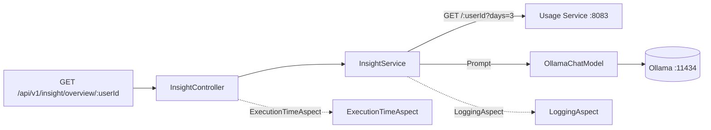

# 💡 Insight Service

   

> Java Spring Boot microservice that turns raw energy usage into **actionable, personalized advice** for the **Energy Tracker** home energy tracking platform.

The **Insight Service** is the AI layer of the platform. It pulls the aggregated consumption of a user's devices from the **Usage Service** over HTTP, feeds that data to a local **Ollama** chat model through **Spring AI**, and returns a natural-language answer: either personalized **saving tips** or a concise **overview** of the consumption, always accompanied by the total energy consumed over the analysed period.

It is a **stateless, read-only** service: it owns no database, consumes no Kafka topics and publishes no events. It only orchestrates two collaborators — the Usage Service (data) and the chat model (reasoning) — which keeps the AI layer independently replaceable.

---

## 📑 Table of Contents

- [Architecture](#-architecture)
- [Tech Stack](#-tech-stack)
- [API Endpoints](#-api-endpoints)
- [Request / Response Examples](#-request--response-examples)
- [How the Insights are Generated](#-how-the-insights-are-generated)
- [Data Model](#-data-model)
- [Getting Started](#-getting-started)
- [Configuration](#-configuration)
- [Testing](#-testing)
- [Error Handling](#-error-handling)
- [Project Structure](#-project-structure)
- [Roadmap](#-roadmap)

---

## 🏗️ Architecture

The service follows a classic three-layer flow: a REST controller receives the request, a service orchestrates the data retrieval and the model call, and two aspects add cross-cutting logging and timing.



- `InsightController` — exposes the two read-only endpoints and documents them with OpenAPI annotations.
- `InsightService` — fetches the usage data, aggregates the total consumption, builds the prompt and wraps the model answer in an `InsightDto`.
- `UsageClient` — `RestClient` based HTTP client against the Usage Service; the base URL is injected from `usage.service.url` through the `usageRestClient` bean.
- `RestClientConfig` — declares the `usageRestClient` bean, built from the auto-configured `RestClient.Builder`, with the Usage Service base URL already applied.
- `OllamaConfig` — declares the `ChatClient` bean with the default system prompt that turns the model into an *expert energy efficiency advisor*.
- `GlobalExceptionHandler` — maps exceptions to a single, stable error contract.

> The chat model is invoked through the `OllamaChatModel` bean (Spring AI) rather than through the `ChatClient` bean, so the per-request prompt is the only thing sent on each call.

---

## 🧰 Tech Stack

| Technology                 | Version    | Purpose                                        |
| -------------------------- | ---------- | ---------------------------------------------- |
| Java                       | 21         | Language / runtime                             |
| Spring Boot                | 4.1.1      | Application framework                          |
| Spring WebMVC              | (SB)       | REST controller                                |
| Spring AI                  | 2.0.1      | `ChatClient` / `OllamaChatModel` abstraction   |
| Ollama                     | —          | Local LLM runtime (model `deepseek-coder`)     |
| RestClient                | (SB)       | HTTP client to the Usage Service               |
| AspectJ (Spring AOP)       | (SB)       | Aspect-oriented logging / timing               |
| jackson-datatype-jsr310    | —          | `Instant` / time API serialization             |
| SpringDoc OpenAPI          | 3.1.1      | Swagger UI / API documentation                 |
| Lombok                     | 1.18.36    | Boilerplate reduction                          |
| Maven                      | —          | Build tool                                     |
| Docker                     | —          | Local infra (MySQL, Redis, Kafka, InfluxDB)   |
| Actuator + Prometheus      | —          | Health / metrics endpoint                      |
| JUnit 5 / Mockito / AssertJ | —        | Testing                                        |

---

## 🔗 API Endpoints

Both endpoints live under the base path `/api/v1/insight`.

> Interactive docs available at [Swagger UI](http://localhost:8085/swagger-ui.html) (OpenAPI spec at [`/v3/api-docs`](http://localhost:8085/v3/api-docs)).

| Method | Path                    | Description                                                  | HTTP statuses       |
| ------ | ----------------------- | ------------------------------------------------------------ | ------------------- |
| `GET`  | `/saving-tips/{userId}` | Personalized tips to reduce consumption + total energy usage | `200`, `400`, `500` |
| `GET`  | `/overview/{userId}`    | Concise analysis of the consumption + total energy usage      | `200`, `400`, `500` |

Path parameters:

- `userId` (path): the user id; must be a valid `Long` (anything else yields `400`).

There are **no** query parameters: the analysed window is fixed by the service to the **last 3 days**.

---

## 📥 Request / Response Examples

### Get the saving tips for user 1

```bash
curl http://localhost:8085/api/v1/insight/saving-tips/1
```

**Response `200 OK`**

```json
{
  "userId": 1,
  "tips": "Consider shifting heavy loads to off-peak hours and unplugging idle devices.",
  "energyUsage": 12.75
}
```

### Get the consumption overview for user 1

```bash
curl http://localhost:8085/api/v1/insight/overview/1
```

**Response `200 OK`**

```json
{
  "userId": 1,
  "tips": "Your consumption is in line with similar households. The HVAC system accounts for most of the load; consider a smart thermostat.",
  "energyUsage": 12.75
}
```

**Response `400 Bad Request`** if the `userId` is not a number:

```json
{
  "status": 400,
  "error": "Bad Request",
  "message": "Parameter 'userId' must be of type 'Long'"
}
```

**Response `500 Internal Server Error`** if the Usage Service or the chat model is unreachable:

```json
{
  "status": 500,
  "error": "Internal Server Error",
  "message": "Unexpected error"
}
```

---

## 🧠 How the Insights are Generated

Both endpoints follow the **same three-step pipeline**, differing only in the prompt that is sent to the model:

1. **Fetch** — `UsageClient.getXDaysUsageForUser(userId, 3)` calls the Usage Service:
   `GET {usage.service.url}/{userId}?days=3`.
2. **Aggregate** — the total consumption is `sum(device.energyConsumed)` over the returned devices. A user with no devices yields `0.0`.
3. **Ask** — a prompt is built and sent to the Ollama chat model; the text of the answer becomes the `tips` field of the response.

The two prompts are different on purpose:

| Endpoint              | Prompt content                                                                 | Goal                                                 |
| --------------------- | ----------------------------------------------------------------------------- | ----------------------------------------------------- |
| `/saving-tips/{id}`   | The **total** consumption only (`4.75`)                                        | *"How can I reduce my energy consumption? How does it compare to average households?"* |
| `/overview/{id}`      | The **full device list** (name, type, location, consumption of each device)    | *"Analyse the data and provide a concise overview with actionable insights."*  |

The chat model is called through the `OllamaChatModel` bean (Spring AI) with a per-request `Prompt`. The `ChatClient` bean declared in `OllamaConfig` carries the **default system prompt** that frames the model as an *expert energy efficiency advisor* and asks it for concise, practical advice.

> The service is **synchronous**: the HTTP request blocks until the model answers. There is no streaming, no queue and no retry.

---

## 🗄️ Data Model

This service has **no database**. Its data lives in two places: the Usage Service (aggregated consumption) and the chat model (the generated text).

### Response DTOs

| DTO            | Fields                                    | Description                                          |
| -------------- | ----------------------------------------- | ---------------------------------------------------- |
| `InsightDto`   | `userId`, `tips`, `energyUsage`           | The generated insight and the total consumption (kWh) |
| `UsageDto`     | `userId`, `devices`                       | Usage data as returned by the Usage Service           |
| `DeviceDto`    | `id`, `name`, `type`, `location`, `energyConsumed` | A device and its aggregated consumption      |
| `ErrorResponse`| `status`, `error`, `message`              | Standard error body for 4xx / 5xx responses           |

### Upstream contract (Usage Service)

The client expects the Usage Service to answer with:

```json
{
  "userId": 1,
  "devices": [
    { "id": 42, "name": "Smart Bulb Salon", "type": "LIGHT", "location": "Salon principal", "energyConsumed": 3.5 },
    { "id": 43, "name": "Frigorifico", "type": "FRIDGE", "location": "Cocina", "energyConsumed": 1.25 }
  ]
}
```

---

## 🚀 Getting Started

### Prerequisites

The service depends on two collaborators:

| Dependency       | Where                      | Required for                                       |
| ---------------- | -------------------------- | -------------------------------------------------- |
| **Usage Service** | `http://localhost:8083`   | The aggregated consumption data                     |
| **Ollama**        | `http://localhost:11434`  | The chat model (`deepseek-coder` must be available) |

The **Usage Service** (`:8083`) expects **Kafka** and **InfluxDB** to be reachable, so the platform infrastructure (MySQL, Redis, Kafka, InfluxDB) is started from the repository root with Docker Compose:

```bash
docker compose up -d
```

The Usage Service itself is a separate Spring Boot application, so it must be started as well (from the `usage-service` folder):

```bash
mvn spring-boot:run
```

> **Ollama is not part of the bundled `docker-compose.yml`.** It must be running locally (or added to the compose file) with the model already pulled:

```bash
# install Ollama from https://ollama.com, then:
ollama serve
ollama pull deepseek-coder
```

### Running locally

1. Start the infrastructure, the Usage Service and Ollama (see above).
2. Run this service:

   ```bash
   mvn spring-boot:run
   ```

3. The service is available at `http://localhost:8085` (Swagger UI at `http://localhost:8085/swagger-ui.html`).

> The consumption data is produced by the **Ingestion Service** (`:8082`) → Kafka → **Usage Service** (`:8083`). You can use the bundled data simulators there to generate traffic.

---


## ⚙️ Configuration

| Property                                | Default                                | Purpose                                       |
| --------------------------------------- | -------------------------------------- | --------------------------------------------- |
| `server.port`                           | `8085`                                 | HTTP port                                     |
| `usage.service.url`                     | `http://localhost:8083/api/v1/usage`   | Usage Service base URL                        |
| `spring.ai.ollama.chat.options.model`   | `deepseek-coder`                       | Chat model used to generate the insights      |
| `spring.ai.ollama.base-url`             | `http://localhost:11434`               | Ollama server address (Spring AI default)     |
| `spring.ai.ollama.init.pull-model-strategy` | `never`                             | Do not pull the model on startup              |
| `management.endpoints.web.exposure.include` | `health,info,prometheus`           | Actuator endpoints exposed                    |
| `springdoc.swagger-ui.path`             | `/swagger-ui.html`                     | Swagger UI path                               |
| `springdoc.group-config[0].group`       | `insight`                              | OpenAPI group for the insight endpoints       |

> `spring.ai.ollama.init.pull-model-strategy=never` means the service **will not** download the model: it must already be present in Ollama, otherwise every call fails with a `500`.

> `usage.service.url` is only read when the `usageRestClient` bean is created. Since it is bound to the `RestClient.Builder` auto-configured by Spring Boot, any application-wide customizer (message converters, observability, SSL) is applied to the outbound calls as well.

---

## 🧪 Testing

```bash
cd insight-service
./mvnw test
```

The suite runs **without any external infrastructure** (no Docker, no Usage Service and no Ollama instance required):

| Test                              | Level       | What it verifies                                                            |
| --------------------------------- | ----------- | --------------------------------------------------------------------------- |
| `UsageClientTest`                 | Unit        | URL/params of the Usage Service call, JSON deserialization, 404 / 500 mapping |
| `InsightServiceTest`              | Unit        | Energy aggregation, prompt content, failure propagation                     |
| `InsightControllerTest`           | Web slice   | `200` payloads, `400` on a non-numeric `userId`, `500` contract              |
| `GlobalExceptionHandlerTest`      | Unit        | Error bodies of validation, type mismatch and generic exceptions            |
| `ExecutionTimeAspectTest`         | Unit        | Timing advice returns the result and propagates exceptions                  |
| `LoggingAspectTest`               | Unit        | `@Before` / `@AfterReturning` advice behaviour                              |
| `OllamaConfigTest`                | Unit        | The `ChatClient` system prompt is configured                                |
| `InsightApiIntegrationTest`       | Integration | Full HTTP flow over a random port with a mocked chat model and usage client |

- The `UsageClient` HTTP calls are stubbed with `MockRestServiceServer`, bound to the `RestClient.Builder` (`MockRestServiceServer.bindTo(builder)`).
- The chat model is mocked with `ChatResponse` / `Generation` / `AssistantMessage` (Spring AI types).
- Spring Boot 4 test slices use `org.springframework.boot.webmvc.test.autoconfigure.WebMvcTest` and `org.springframework.test.context.bean.override.mockito.MockitoBean`.
- `InsightServiceApplicationTests` boots the full Spring context to verify the application wiring.

Current status: **34 tests, 0 failures**.

---

## 🛑 Error Handling

Errors are centralized in `GlobalExceptionHandler` (`@RestControllerAdvice`). All error responses share a common `ErrorResponse` body: `{ "status": ..., "error": ..., "message": ... }`.

| Exception                          | HTTP status | Reason                                             |
| ---------------------------------- | ----------- | -------------------------------------------------- |
| `MethodArgumentNotValidException`  | `400`       | Request body validation failed                     |
| `MethodArgumentTypeMismatchException` | `400`    | `userId` is not a valid `Long`                     |
| `Exception` (generic fallback)     | `500`       | Unexpected error (Usage Service / Ollama failure)  |

> Failures coming from the **Usage Service** (`RestClientException`) or from the **chat model** are not handled explicitly, so they fall into the generic `500` handler and the response message is `"Unexpected error"`.

---

## 📁 Project Structure

```
insight-service
├── pom.xml
├── src
│   ├── main
│   │   ├── java/com/pgs/insight/service
│   │   │   ├── InsightServiceApplication.java
│   │   │   ├── aspect
│   │   │   │   ├── ExecutionTimeAspect.java
│   │   │   │   └── LoggingAspect.java
│   │   │   ├── client
│   │   │   │   └── UsageClient.java
│   │   │   ├── config
│   │   │   │   ├── OllamaConfig.java
│   │   │   │   ├── OpenApiConfig.java
│   │   │   │   └── RestClientConfig.java
│   │   │   ├── controller
│   │   │   │   └── InsightController.java
│   │   │   ├── dto
│   │   │   │   ├── DeviceDto.java
│   │   │   │   ├── ErrorResponse.java
│   │   │   │   ├── InsightDto.java
│   │   │   │   └── UsageDto.java
│   │   │   ├── exception
│   │   │   │   └── GlobalExceptionHandler.java
│   │   │   └── service
│   │   │       └── InsightService.java
│   │   └── resources
│   │       └── application.properties
│   └── test
│       └── java/com/pgs/insight/service
│           ├── InsightServiceApplicationTests.java
│           ├── aspect
│           │   ├── ExecutionTimeAspectTest.java
│           │   └── LoggingAspectTest.java
│           ├── client
│           │   └── UsageClientTest.java
│           ├── config
│           │   └── OllamaConfigTest.java
│           ├── controller
│           │   └── InsightControllerTest.java
│           ├── exception
│           │   └── GlobalExceptionHandlerTest.java
│           ├── integration
│           │   └── InsightApiIntegrationTest.java
│           └── service
│               └── InsightServiceTest.java
```

---

## 🗺️ Roadmap

- [ ] Add an Ollama service to the bundled `docker-compose.yml` so the whole platform can be started with a single command.
- [ ] Make the analysed window configurable (`?days=` query parameter) instead of the hardcoded 3 days.
- [ ] Stream the model answer with SSE so long generations are not blocked.
- [ ] Add a timeout / retry / circuit breaker around the `UsageClient` and the chat model calls.
- [ ] Persist the generated insights so they can be listed later and compared over time.
- [ ] Expose the model and the system prompt as configurable properties.
- [ ] Add an integration test against a real Ollama instance via Testcontainers.
