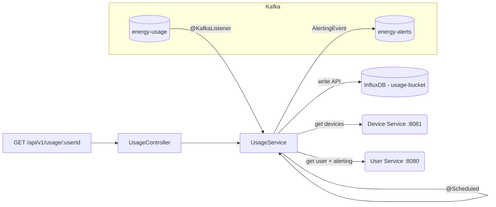

# 📈 Usage Service

  

> Java Spring Boot microservice that aggregates, stores and alerts on the energy usage of the **Energy Tracker** home energy tracking platform.

The **Usage Service** is the analytical heart of the platform. It consumes raw energy readings from Kafka, persists them in **InfluxDB** (a time-series database), runs a scheduled aggregation every 10 seconds, raises an alert event when a user's consumption exceeds their configured threshold, and exposes a REST API to query aggregated usage. It also integrates with the **Device Service** and the **User Service** over HTTP to resolve ownership and alerting preferences.

---

## 📑 Table of Contents

- [Architecture](#-architecture)
- [Tech Stack](#-tech-stack)
- [API Endpoints](#-api-endpoints)
- [Request / Response Examples](#-request--response-examples)
- [Data Model](#-data-model)
- [How Alerting Works](#-how-alerting-works)
- [Getting Started](#-getting-started)
- [Configuration](#-configuration)
- [Actuator & Metrics](#-actuator--metrics)
- [Testing](#-testing)
- [Error Handling](#-error-handling)
- [Project Structure](#-project-structure)
- [Roadmap](#-roadmap)

---

## 🏗️ Architecture

The service is built around three cooperating loops: consuming readings from Kafka, aggregating them on a schedule (with optional alerting), and serving them over REST.



Readings persist as InfluxDB points in the `energy_usage` measurement. Aggregated usage is queried with **Flux**, and alerts are published to `energy-alerts` as `AlertingEvent` messages (fire-and-forget via `KafkaTemplate`).

---

## 🧰 Tech Stack

| Technology            | Version    | Purpose                                   |
| --------------------- | ---------- | ----------------------------------------- |
| Java                  | 21         | Language / runtime                        |
| Spring Boot           | 4.1.1      | Application framework                     |
| Spring WebMVC         | (SB)       | REST controller                           |
| Spring for Kafka      | (SB)       | Producer + consumer (`KafkaTemplate`)     |
| Apache Kafka          | KRaft      | Message broker (local infra via docker)   |
| InfluxDB              | 2.7        | Time-series storage of energy readings    |
| influxdb-client-java  | 6.12.0     | Write / query InfluxDB (Flux)             |
| AspectJ (Spring AOP)  | (SB)       | Aspect-oriented logging / timing          |
| Spring Boot Actuator  | (SB)       | Health, info and metrics endpoints        |
| Micrometer Prometheus Registry | (SB) | Metrics in Prometheus exposition format |
| RestClient            | (SB)       | HTTP clients to Device / User services    |
| jackson-datatype-jsr310 | —        | `Instant` / time API serialization        |
| SpringDoc OpenAPI     | 3.1.1      | Swagger UI / API documentation            |
| Lombok                | 1.18.36    | Boilerplate reduction                     |
| Maven                 | —          | Build tool                                |
| Docker                | —          | Local infra via `docker-compose`          |
| Actuator + Prometheus | —          | Health / metrics endpoint                 |
| JUnit 5 / Mockito / AssertJ | —  | Testing                                   |

---

## 🔗 API Endpoints

The single query endpoint is under the base path `/api/v1/usage`.

> Interactive docs available at [Swagger UI](http://localhost:8083/swagger-ui.html) (OpenAPI spec at [`/v3/api-docs`](http://localhost:8083/v3/api-docs), group `usage`).

| Method | Path              | Description                                              | HTTP statuses                           |
| ------ | ----------------- | -------------------------------------------------------- | --------------------------------------- |
| `GET`  | `/{userId}`       | Aggregated energy usage of a user's devices over `days` (default `3`, `1..365`) | `200`, `400` |

Query parameters:

- `userId` (path): the user id; must be `> 0`.
- `days` (query, optional, default `3`): number of days to look back; must be between `1` and `365`.

---

## 📥 Request / Response Examples

### Get the last 3 days of energy usage for user 1

```http
GET /api/v1/usage/1?days=3
```

**Response `200 OK`**

```json
{
  "userId": 1,
  "devices": [
    {
      "id": 42,
      "name": "Smart Bulb Sala",
      "type": "LIGHT",
      "location": "Salon principal",
      "userId": 1,
      "energyConsumed": 3.5
    },
    {
      "id": 43,
      "name": "Frigorifico",
      "type": "FRIDGE",
      "location": "Cocina",
      "userId": 1,
      "energyConsumed": 12.7
    }
  ]
}
```

**Response `400 Bad Request`** if the parameters are invalid (for example `days=0`):

```json
{
  "status": 400,
  "error": "Bad Request",
  "message": "days: must be greater than or equal to 1"
}
```

---
## 🗄️ Data Model

This service has **no relational database**. Its data lives in two places:

### InfluxDB (measurement `energy_usage`)

| Element            | Kind    | Description                              |
| ------------------ | ------- | ---------------------------------------- |
| `deviceId`         | tag     | The device that produced the reading     |
| `energyConsumed`   | field   | Energy consumed (kWh)                    |
| `time`             | time    | Timestamp of the reading (ms precision)  |

### Kafka events

| Topic            | Payload          | Direction |
| ---------------- | ---------------- | --------- |
| `energy-usage`   | `EnergyUsageEvent(deviceId, energyConsumed, timestamp)`  | consumed by this service |
| `energy-alerts`  | `AlertingEvent(userId, message, threshold, energyConsumed, email)` | produced by this service |

---

## 🔔 How Alerting Works

A `@Scheduled(cron = "*/10 * * * * *")` task (enabled via `@EnableScheduling`) runs every 10 seconds and:

1. Queries InfluxDB for the sum of `energyConsumed` per device over the **past hour**.
2. Resolves the owner of each device through the **Device Service** (`GET /api/v1/device/{deviceId}`); for the usage query it walks the **paginated** `GET /api/v1/device/user/{userId}?page&size` endpoint, reading the `content` of every page until `last` is `true`.
3. Groups consumption per user and fetches the matching users from the **User Service**.
4. **Only users with `alerting = true` are considered** (the flag is managed in the User Service).
5. If a user's total consumption exceeds their `energyAlertingThreshold`, an `AlertingEvent` is published to `energy-alerts`.
6. **Cooldown:** an alert is published for a user at most once every `app.alerting.cooldown-minutes` (default `60`), so a user that stays above their threshold does not produce a new event — and a new email — on every execution of the task.

The threshold and the on/off switch are configured per user in the **User Service** (`POST /api/v1/user`, `PATCH /api/v1/user/{id}/alerting`), so no alert configuration lives in this service.

> ⚠️ **The cooldown state lives in memory** (one timestamp per user), so it is **lost when the service restarts** and it is **not shared between instances**. After a restart one alert per user still above their threshold may be re-sent.
>
> 💡 A **user deleted while its devices (and their readings) still exist** makes the User Service answer `404`. That is an expected situation: the user is skipped and logged at `debug` level, without a stack trace and without affecting the rest of the aggregation.

---

## 🚀 Getting Started

### Prerequisites

The service depends on **Kafka** and **InfluxDB**. Those, together with MySQL and Redis (used by the other microservices), are started from the repository root with Docker Compose. The usage service also expects the **Device Service** (`:8081`) and the **User Service** (`:8080`) to be reachable.

InfluxDB is initialised on first run with:

- Org: `home-energy-tracker`
- Bucket: `usage-bucket`
- Admin token: `my-token`

### Running locally

1. Start the infrastructure (from the repository root):

   ```bash
   docker compose up -d
   ```

2. Run the service:

   ```bash
   mvn spring-boot:run
   ```

3. The service is available at `http://localhost:8083` (Swagger UI at `http://localhost:8083/swagger-ui.html`).

> The consumed readings are produced by the **Ingestion Service** (`:8082`), which publishes to `energy-usage`. You can use the bundled data simulators there to generate traffic.

---

## ⚙️ Configuration

| Property                                   | Default                                   | Purpose                                  |
| ------------------------------------------ | ----------------------------------------- | ---------------------------------------- |
| `server.port`                              | `8083`                                    | HTTP port                                |
| `spring.kafka.bootstrap-servers`           | `localhost:9094`                          | Kafka broker (EXTERNAL listener)         |
| `spring.kafka.consumer.group-id`           | `usage-service`                           | Consumer group for `energy-usage`        |
| `spring.kafka.template.default-topic`      | `energy-alerts`                           | Topic for alert events                   |
| `influx.url`                               | `http://localhost:8072`                   | InfluxDB address                         |
| `influx.token`                             | `my-token`                                | InfluxDB API token                       |
| `influx.org`                               | `home-energy-tracker`                     | InfluxDB organisation                    |
| `influx.bucket`                            | `usage-bucket`                            | InfluxDB bucket                          |
| `device.service.url`                       | `http://localhost:8081/api/v1/device`     | Device Service base URL                  |
| `user.service.url`                         | `http://localhost:8080/api/v1/user`       | User Service base URL                    |
| `device.service.page-size`                 | `100`                                     | Page size used while walking the paginated Device Service endpoints |
| `app.alerting.cooldown-minutes`            | `60`                                      | Minimum minutes between two alerts for the same user (state kept in memory) |
| `management.endpoints.web.exposure.include` | `health,info,prometheus`                  | Actuator endpoints exposed               |
| `management.endpoint.health.show-details`  | `when-authorized`                          | Health detail visibility                 |
| `management.metrics.tags.application`      | `usage-service`                            | Common tag added to all metrics          |
| `springdoc.swagger-ui.path`                | `/swagger-ui.html`                        | Swagger UI path                          |
| `springdoc.api-docs.path`                  | `/v3/api-docs`                            | OpenAPI spec path                        |
| `springdoc.group-configs[0].group`          | `usage`                                   | OpenAPI group for the usage endpoints    |

---

## 📊 Actuator & Metrics

The service ships **Spring Boot Actuator** and the **Micrometer Prometheus registry**, so its runtime metrics are exposed in Prometheus exposition format and scraped every 15 seconds by the `prometheus` container declared in [`docker-compose.yml`](../docker-compose.yml) (job `usage-service` in [`docker/prometheus/prometheus.yml`](../docker/prometheus/prometheus.yml)).

| Endpoint               | Purpose                                                 |
| ---------------------- | ------------------------------------------------------- |
| `/actuator/health`     | Liveness / readiness probe                              |
| `/actuator/info`       | Application & build information                         |
| `/actuator/prometheus` | Metrics in Prometheus exposition format (scrape target) |

```bash
curl http://localhost:8083/actuator/health
curl http://localhost:8083/actuator/prometheus
```

Every meter is tagged with `application=usage-service` (`management.metrics.tags.application`), which makes per-service filtering trivial in Grafana — reachable at [http://localhost:3000](http://localhost:3000) (`admin` / `admin`) with the Prometheus datasource already provisioned.

---

## 🧪 Testing

The suite runs **without external infrastructure** (no Docker / Kafka / InfluxDB required): the Spring context smoke test uses the test configuration, and the HTTP clients are unit-tested against a mocked `RestServer`.

Run the tests with:

```bash
cd usage-service
./mvnw test          # macOS/Linux
.\mvnw.cmd test      # Windows
```

| Test                             | Level       | What it verifies                                       |
| -------------------------------- | ----------- | ------------------------------------------------------ |
| `UsageServiceApplicationTests`   | Smoke       | The Spring application context loads                   |
| `DeviceClientTest`               | Unit        | `DeviceClient` walks the paginated `PageResponse` of the Device Service page by page, maps devices and handles errors |
| `UserClientTest`                 | Unit        | `UserClient` maps user responses / handles errors      |
| `UsageServiceTest`               | Unit (Mockito) | Aggregation query, threshold evaluation, deleted users (`404`), per-user alert cooldown and the Kafka listener write path |

> The scheduled aggregation, the threshold checks, the alert cooldown and the Kafka listener are covered by `UsageServiceTest` with mocked collaborators (a controllable `Clock` drives the cooldown tests). A `WebMvcTest` for `UsageController` and a full E2E test with real Kafka + InfluxDB are still pending — see the [Roadmap](#-roadmap).

---

## 🛑 Error Handling

Errors are centralized in `GlobalExceptionHandler` (`@RestControllerAdvice`). All error responses share a common `ErrorResponse` body: `{ "status": ..., "error": ..., "message": ... }`.

| Exception                                    | HTTP status | Reason                          |
| -------------------------------------------- | ----------- | ------------------------------- |
| `ConstraintViolationException`               | `400`       | Param validation (`@Positive`, `@Min`, `@Max`) |
| `HandlerMethodValidationException`           | `400`       | Method/param validation         |
| `MethodArgumentNotValidException`            | `400`       | Malformed / unreadable body     |
| `Exception` (generic fallback)               | `500`       | Unexpected error                 |

> 🔎 **Downstream errors:** a `404` from the User Service for a user that still has devices and readings (a deleted user) is **not** an error of this service: the user is skipped during the aggregation and logged at `debug` level. Connectivity problems or `5xx` responses from the Device/User services are logged at `warn` and the affected user/device is skipped, so one unreachable service never aborts the whole aggregation.

---

## 📁 Project Structure

```
usage-service
├── pom.xml
├── src
│   ├── main
│   │   ├── java/com/pgs
│   │   │   ├── kafka/event
│   │   │   │   ├── AlertingEvent.java
│   │   │   │   └── EnergyUsageEvent.java
│   │   │   └── usage/service
│   │   │       ├── UsageServiceApplication.java
│   │   │       ├── aspect
│   │   │       │   ├── ExecutionTimeAspect.java
│   │   │       │   └── LoggingAspect.java
│   │   │       ├── client
│   │   │       │   ├── DeviceClient.java
│   │   │       │   └── UserClient.java
│   │   │       ├── config
│   │   │       │   ├── ClockConfig.java
│   │   │       │   ├── InfluxDBConfig.java
│   │   │       │   ├── OpenApiConfig.java
│   │   │       │   └── RestClientConfig.java
│   │   │       ├── controller
│   │   │       │   └── UsageController.java
│   │   │       ├── dto
│   │   │       │   ├── DeviceDto.java
│   │   │       │   ├── ErrorResponse.java
│   │   │       │   ├── PageResponse.java
│   │   │       │   ├── UsageDto.java
│   │   │       │   └── UserDto.java
│   │   │       ├── exception
│   │   │       │   └── GlobalExceptionHandler.java
│   │   │       ├── model
│   │   │       │   ├── Device.java
│   │   │       │   └── DeviceEnergy.java
│   │   │       └── service
│   │   │           └── UsageService.java
│   │   └── resources
│   │       └── application.properties
│   └── test
│       └── java/com/pgs/usage/service
│           ├── UsageServiceApplicationTests.java
│           ├── client
│           │   ├── DeviceClientTest.java
│           │   └── UserClientTest.java
│           └── service
│               └── UsageServiceTest.java
```

---

## 🗺️ Roadmap

- [x] Add unit tests for `UsageService` (Kafka listener, aggregation, threshold checks) using mocks.
- [ ] Persist the alert cooldown (Redis or a Kafka state store) so it survives restarts and is shared between instances — today it is an in-memory map.
- [ ] Cascade the deletion of a user's devices (and their InfluxDB readings) when the user is removed, instead of leaving orphan devices/measurements that keep being aggregated.
- [ ] Add a `WebMvcTest` for `UsageController` covering validation and error responses.
- [ ] Add an E2E test with a real Kafka + InfluxDB via Testcontainers.
- [ ] Add an outbox / durable source of truth for alert events to avoid loss if Kafka is down.
- [ ] Add graceful fallback if Device / User services are temporarily unreachable during aggregation.
- [ ] Expose the usage API through the API Gateway (no route registered yet).
